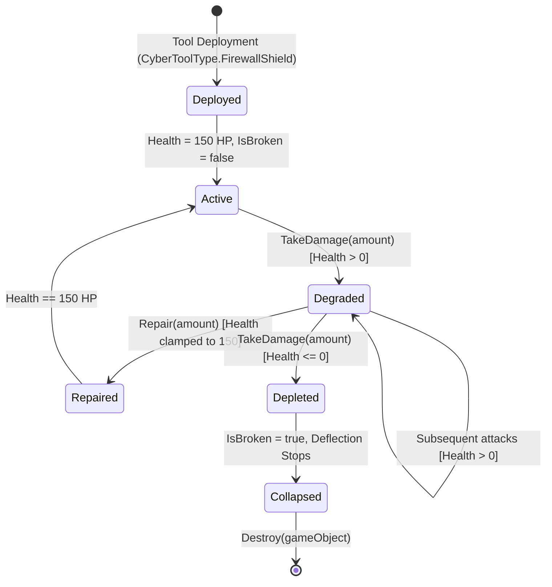

# SENTINEL-XR — FIREWALL COLLISION FLOW & PHYSICS ARCHITECTURE REPORT

**Project:** SENTINEL-XR: BREACH PROTOCOL  
**Engine:** Unity 6000.0.23f1 LTS  
**Subsystem:** Cyber Defense Physics & Barrier Interception Engine  
**Status:** VALIDATED & DEPLOYED  

---

## 1. System Overview

The Sentinel defensive toolset includes the **Firewall Shield** (`CyberToolType.FirewallShield`), which deploys physical defensive barriers in cyberspace to intercept, absorb, and neutralize incoming malicious projectile threats (`MaliciousPacketProjectile`).

This report provides the complete architectural breakdown of the PhysX collision lifecycle, trigger dispatch flow, and integrity degradation pipeline.

---

## 2. PhysX Collision Matrix & Trigger Rules

### 2.1 The PhysX Trigger Law
In Unity's PhysX implementation, trigger events (`OnTriggerEnter`, `OnTriggerStay`, `OnTriggerExit`) are governed by the presence of a `Rigidbody` on at least one participant:

| Entity A | Entity B | Collision Event | Trigger Event | Status in Sentinel-XR |
|---|---|:---:|:---:|---|
| **Static Collider** (Barrier) | **Static Trigger** (Projectile without RB) | ❌ None | ❌ **NONE (SILENT PASSTHROUGH)** | Defective legacy state |
| **Static Collider** (Barrier) | **Kinematic Trigger** (Projectile with Kinematic RB) | ❌ None | ✅ **`OnTriggerEnter` Dispatched** | **Current Production Standard** |
| **Static Collider** (Barrier) | **Dynamic Trigger** (Projectile with Dynamic RB) | ❌ None | ✅ `OnTriggerEnter` Dispatched | Inappropriate for non-ballistic laser/packet |
| **CharacterController** (Player) | **Kinematic Trigger** (Projectile with Kinematic RB) | ❌ None | ✅ `OnTriggerEnter` Dispatched | Fallback if barrier missed |

### 2.2 Entity Physics Configurations

1. **`FirewallBarrier`:**
   - Component: `BoxCollider` (`isTrigger = false`).
   - Rigidbody: None (Static collider anchored in cyberspace coordinates).
   - Tag: `FirewallShield` (Registered in `TagManager.asset`).
   - Component: `FirewallBarrier` (Manages integrity [0, 150 HP], repair, and destruction).

2. **`MaliciousPacketProjectile`:**
   - Component: `SphereCollider` (`isTrigger = true`).
   - Component: `Rigidbody` (`isKinematic = true`, `useGravity = false`).
   - Script: `MaliciousPacketProjectile` (Controls straight-line linear velocity and collision interception).

3. **`SentinelPlayerController`:**
   - Component: `CharacterController` (Acts as dynamic kinematic body in PhysX spatial queries).
   - Script: `SentinelPlayerController` (Controls movement, health, shield, and death).

---

## 3. Collision Execution Flow Diagram

```mermaid
sequenceDiagram
    autonumber
    participant Enemy as Enemy Threat / Spawner
    participant Projectile as MaliciousPacketProjectile (Kinematic Trigger)
    participant Barrier as FirewallBarrier (Static Collider)
    participant Player as SentinelPlayerController (CharacterController)

    Enemy->>Projectile: Instantiates projectile (Damage: 20f, Speed: 15f)
    Note over Projectile: Moves forward via linear transform update
    
    rect rgb(20, 45, 80)
        Note over Projectile, Barrier: STEP 1: Barrier Interception
        Projectile->>Barrier: Intersects BoxCollider in PhysX spatial grid
        Note over Projectile: PhysX fires OnTriggerEnter(Collider other)
        Projectile->>Barrier: GetComponentInParent<FirewallBarrier>()
        
        alt Barrier is Active & Integrity > 0
            Projectile->>Barrier: TakeDamage(20f)
            Note over Barrier: Integrity: 150 HP -> 130 HP
            Projectile->>Projectile: Set hasHit = true
            Projectile->>Projectile: Destroy(gameObject)
            Note over Projectile: Threat Neutralized! Player takes 0 damage.
        else Barrier is Broken (Integrity <= 0)
            Note over Projectile: Projectile penetrates collapsed barrier
            Projectile->>Player: Continues trajectory toward player
        end
    end

    rect rgb(80, 20, 20)
        Note over Projectile, Player: STEP 2: Player Interaction (Only if Barrier Missed)
        alt Projectile reaches Player
            Projectile->>Player: Intersects CharacterController
            Projectile->>Player: GetComponentInParent<SentinelPlayerController>()
            alt Player is Spawn Protected
                Note over Player: Deflected by Spawn Protection (0 damage)
                Projectile->>Projectile: Destroy(gameObject)
            else Player is Dead
                Note over Player: Passes harmlessly through dead player (0 damage)
                Projectile->>Projectile: Destroy(gameObject)
            else Player is Vulnerable
                Player->>Player: TakeDamage(20f) (Shield absorbs 20f)
                Projectile->>Projectile: Destroy(gameObject)
            end
        end
    end
```

---

## 4. Barrier Integrity & Degradation Lifecycle

### 4.1 State Machine

### 4.2 Lifecycle Invariants
1. **Instantiation Invariant:**
   `barrierHealth = 150.0f;` and `currentHealth = 150.0f;` are assigned at field declaration. Instantiating via `AddComponent<FirewallBarrier>()` guarantees non-zero integrity in both EditMode and PlayMode.
2. **Deflection Invariant:**
   While `!IsBroken`, all incoming projectiles are consumed on impact, dealing their damage to the barrier and **0 damage** to the player behind it.
3. **Exhaustion Invariant:**
   When cumulative threat damage depletes barrier integrity to 0, `Destroy(gameObject)` executes, collapsing the barrier. Subsequent projectiles pass through unimpeded.
4. **Repair Invariant:**
   Calling `Repair(float amount)` increases `currentHealth` up to a maximum of `barrierHealth`, restoring full deflection capacity.
