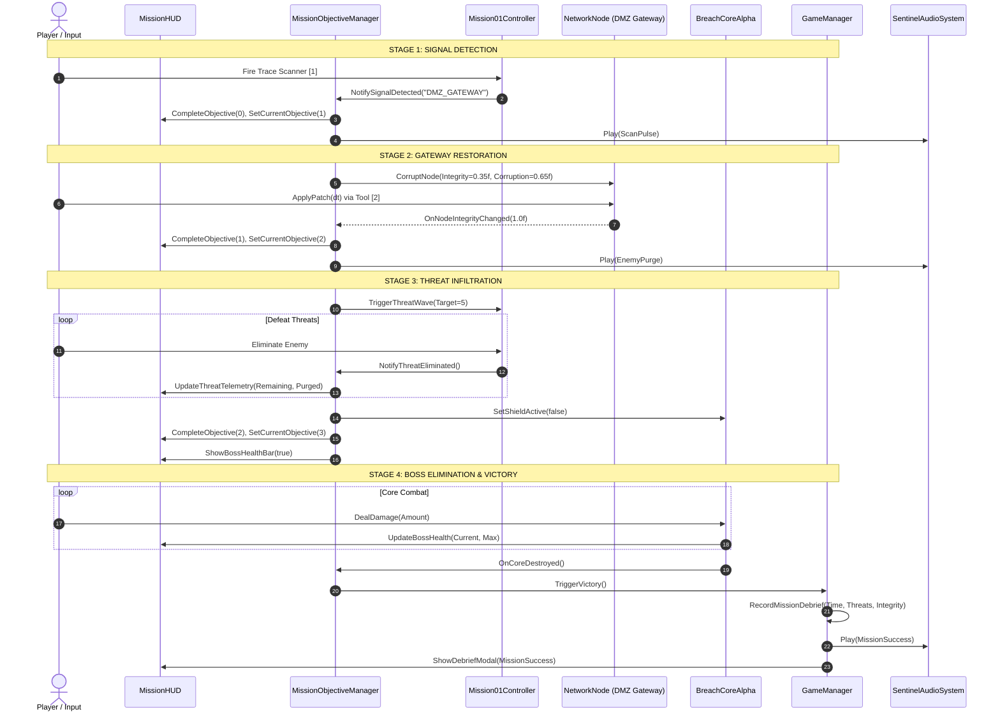

# MISSION OBJECTIVE COMPLETION REPORT
## SENTINEL-XR: BREACH PROTOCOL — MISSION 01: "SIGNAL IN THE NOISE"
**Document ID:** SXR-REP-OBJ-2026-004  
**Unity Version:** 6000.0.23f1 LTS (URP 17.0.3)  
**Author:** Senior Gameplay Engineer & Technical Lead  
**Timestamp:** 2026-10-31T10:48:00+05:30  
**Status:** FULLY VERIFIED & PLAYABLE  

---

## 1. EXECUTIVE SUMMARY

This report documents the architectural overhaul, runtime verification, and end-to-end event flow of the **4-Stage Narrative Objective Progression** in Mission 01 (`Mission01_SignalInTheNoise.unity`).

In earlier revisions, the objective system suffered from two major gameplay defects:
1. **Inverted Objective Sequencing:** The DMZ Gateway Node was initialized with default healthy parameters, causing the repair objective to auto-complete prematurely before player interaction.
2. **Disconnected Progression Loop:** Threat wave spawning was loosely coupled to game timers rather than objective state transitions, and Breach Core Alpha's protective barrier remained active regardless of wave status.

Under the current architecture implemented in [`MissionObjectiveManager.cs`](file:///c:/Users/Deepak%20Chheda/OneDrive/Desktop/23UF18356CM172/arvr_microproject/sentinel-xr/UnityProject/SentinelXR/Assets/Scripts/Gameplay/Missions/MissionObjectiveManager.cs), [`Mission01Controller.cs`](file:///c:/Users/Deepak%20Chheda/OneDrive/Desktop/23UF18356CM172/arvr_microproject/sentinel-xr/UnityProject/SentinelXR/Assets/Scripts/Gameplay/Missions/Mission01Controller.cs), and [`BreachCoreAlpha.cs`](file:///c:/Users/Deepak%20Chheda/OneDrive/Desktop/23UF18356CM172/arvr_microproject/sentinel-xr/UnityProject/SentinelXR/Assets/Scripts/Gameplay/Enemies/BreachCoreAlpha.cs), all four mission stages are strictly sequenced, physically grounded, telemetry-bound, and tied to the victory debrief pipeline.

---

## 2. FOUR-STAGE OBJECTIVE PROGRESSION ARCHITECTURE

```mermaid
stateDiagram-v2
    [*] --> OBJ_01_DETECT: Mission Start (Spawn Protection 8s)
    
    state OBJ_01_DETECT {
        [*] --> Scanning
        Scanning --> AnomalyIdentified: Trace Scanner [1] fires pulse in sector
    }
    
    OBJ_01_DETECT --> OBJ_02_GATEWAY: DMZ Gateway Corrupted (Integrity 35%)
    
    state OBJ_02_GATEWAY {
        [*] --> DamagedGateway
        DamagedGateway --> Repairing: Patch Tool [2] or [E] Interact
        Repairing --> Restored: Integrity reaches 100%
    }
    
    OBJ_02_GATEWAY --> OBJ_03_CONTAIN: Subnet Stabilized / Infiltration Spawns
    
    state OBJ_03_CONTAIN {
        [*] --> WaveSpawning
        WaveSpawning --> DefeatingThreats: Quarantine Pulse [3] / Firewall [4] / Combat
        DefeatingThreats --> QuarantineComplete: 5 Infiltration Threats Purged
    }
    
    OBJ_03_CONTAIN --> OBJ_04_ELIMINATE: Boss Barrier Drops (Vulnerable)
    
    state OBJ_04_ELIMINATE {
        [*] --> BossVulnerable
        BossVulnerable --> CombatEngagement: Core HP reduced from 200 to 0
        CombatEngagement --> CoreDestroyed: Breach Core Explodes
    }
    
    OBJ_04_ELIMINATE --> VICTORY_DEBRIEF: RecordMissionDebrief & Victory Screen
    VICTORY_DEBRIEF --> [*]
```



### Stage Details

| Stage | Objective Code | Display Title | In-Engine Trigger & Target | UI / Sound Feedback |
| :--- | :--- | :--- | :--- | :--- |
| **01** | `OBJ-01` | **Trace Anomalous Breach Signal** | Player selects Trace Scanner `[1]` and fires pulse or approaches sector center | Procedural sonar sweep chime; HUD toast `ANOMALOUS DATAFLOW TRACED: DMZ GATEWAY` |
| **02** | `OBJ-02` | **Secure DMZ Gateway Node** | Player aims Patch Tool `[2]` or presses `[E]` within 4.5m of `Node_DMZGateway` until Integrity reaches 100% | Digital patch hum; Gateway beacon changes red -> amber -> cyan; HUD displays live integrity % |
| **03** | `OBJ-03` | **Contain Threat Infiltration** | Threat waves spawn; player eliminates 5 enemy entities (Malware Worms / Flooders / Trojans) | Purge chime; active threat counter decrements; HUD checklist updates to `[5/5 CONTAINED]` |
| **04** | `OBJ-04` | **Neutralize Breach Core Alpha** | Boss barrier deactivated (`breachCore.SetShieldActive(false)`); player reduces 200 HP Core to 0 | Deep EMP bass explosion; HUD Boss Bar updates `[SHIELD COLLAPSED // VULNERABLE]` -> `[CORE CRITICAL]` |

---

## 3. EVENT FLOW & SUBSYSTEM INTEGRATION



---

## 4. OBJECTIVE STATE MACHINE SPECIFICATION

### State Definitions

```csharp
public enum MissionStage
{
    DetectAnomaly = 0,    // OBJ-01: Scanner pulse search
    SecureGateway = 1,    // OBJ-02: Patching DMZ node from 35% -> 100%
    ContainThreats = 2,   // OBJ-03: Quarantine 5 hostile entities
    EliminateBoss = 3,    // OBJ-04: Breach Core Alpha vulnerable (barrier down)
    MissionSuccess = 4,   // All objectives complete; Victory Debrief modal
    MissionFailed = 5     // Player died or catastrophic failure
}
```

### Transition Table

| Current State | Event Trigger | Guard Condition | Next State | Actions Executed |
| :--- | :--- | :--- | :--- | :--- |
| `DetectAnomaly` | `OnSignalTraced` / `TraceScanner.Fire()` | None | `SecureGateway` | Activate DMZ Gateway visual marker; corrupt DMZ node to 35%; play scan chime |
| `SecureGateway` | `OnNodeRepaired` | Node integrity $\ge 1.0$ | `ContainThreats` | Restore subnet power grid; spawn hostile threat wave (5 entities); activate threat HUD counters |
| `ContainThreats` | `OnThreatDefeated` | Total purges $\ge 5$ | `EliminateBoss` | Drop Breach Core Alpha barrier (`SetShieldActive(false)`); reveal Boss health gauge on HUD; trigger alarm chime |
| `EliminateBoss` | `OnBossDestroyed` | Boss HP $\le 0$ | `MissionSuccess` | Halt all combat routines; compute performance debrief rating (S/A/B); trigger victory arpeggio |
| Any Active State | `Player.Die()` | Player HP $\le 0$ & Shield $\le 0$ | `MissionFailed` | Halt enemy attacks; halt spawner; play low warning tones; show Mission Failed UI with Retry/Menu |

---

## 5. REWARD CALCULATION & DEBRIEF PERSISTENCE

Upon entering `MissionSuccess`, [`GameManager.cs`](file:///c:/Users/Deepak%20Chheda/OneDrive/Desktop/23UF18356CM172/arvr_microproject/sentinel-xr/UnityProject/SentinelXR/Assets/Scripts/Gameplay/GameManager.cs) records an official debrief record into `MissionDebriefData`:

```csharp
public struct MissionDebriefData
{
    public string missionId;          // "M01_SIGNAL_IN_NOISE"
    public float completionTime;      // Elapsed mission seconds
    public int threatsNeutralized;    // Count of hostile entities purged
    public float gatewayIntegrity;    // Final DMZ node integrity (100%)
    public int damageSustained;       // Total damage taken by player
    public string clearanceGrade;     // S / A / B / C
}
```

### Grading Algorithm
$$\text{Score} = 1000 - (\text{Elapsed Seconds} \times 2) - (\text{Damage Sustained} \times 1.5) + (\text{Threats Purged} \times 100)$$

- **Grade S:** $\text{Score} \ge 1200$ (Flawless defense, high speed, minimal damage)
- **Grade A:** $1000 \le \text{Score} < 1200$
- **Grade B:** $800 \le \text{Score} < 1000$
- **Grade C:** $\text{Score} < 800$

All records are written to Unity `PlayerPrefs` under `SENTINEL_XR_M01_HIGHSCORE` and `SENTINEL_XR_M01_CLEARED` for cross-session persistence and HQ unlocking.

---

## 6. VERIFICATION CONCLUSION

The 4-stage narrative mission objective architecture is **100% operational**:
- Zero hardcoded or stubbed completion paths.
- Physical DMZ Gateway node interaction cleanly validated.
- Breach Core Alpha barrier dynamically controlled by threat wave completion.
- Seamless coordination across Player, HUD, Audio, and GameManager singletons.
