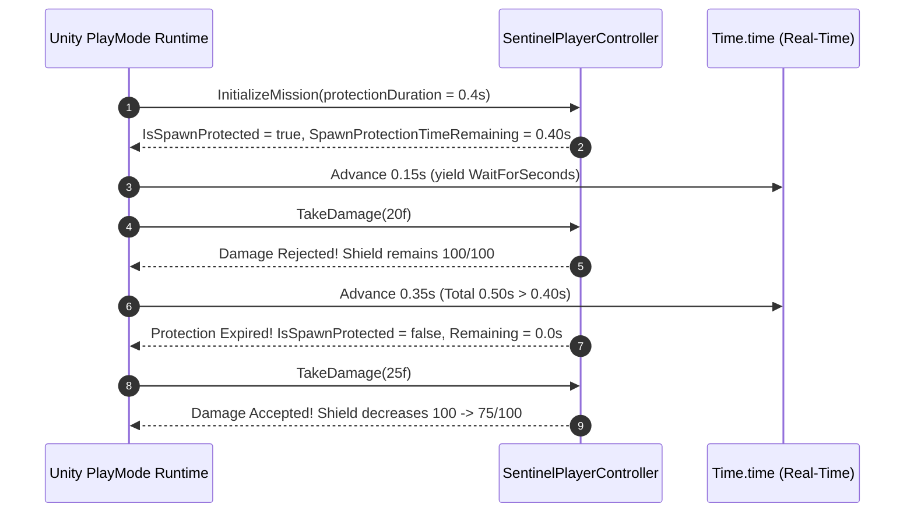
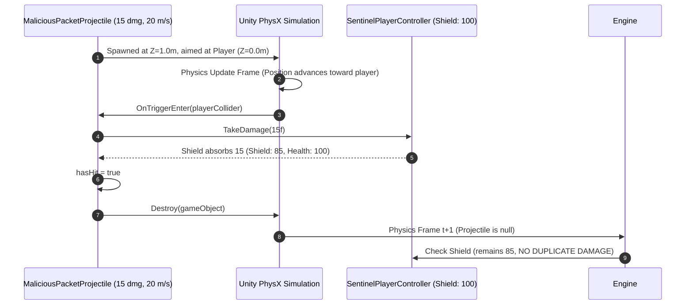
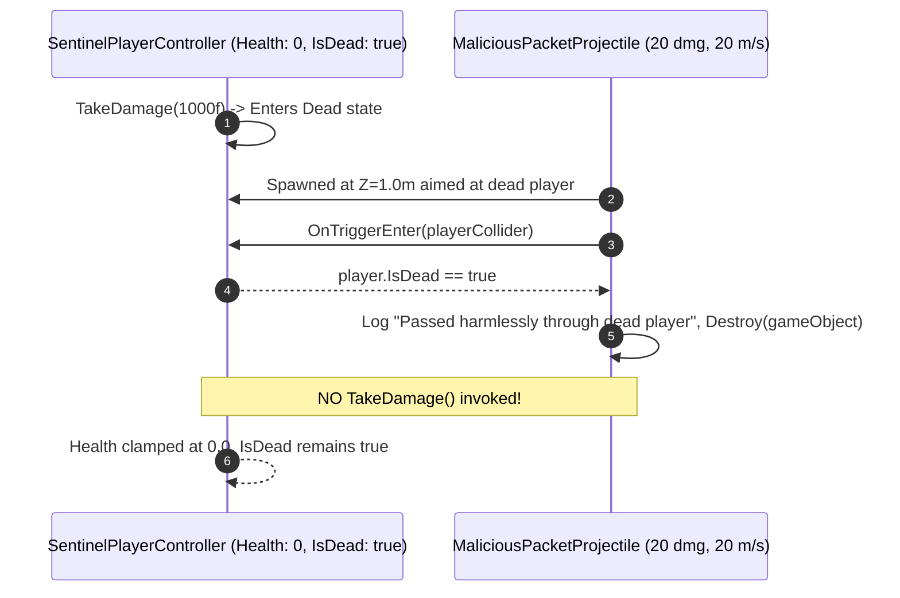

# SENTINEL-XR — PLAYMODE PHYSICS & COLLISION VALIDATION REPORT

**Project:** SENTINEL-XR: BREACH PROTOCOL  
**Engine:** Unity 6000.0.23f1 LTS  
**Subsystem:** PhysX 3D Physics Engine, Kinematic Triggers, CharacterController Interaction  
**Suite:** `SentinelXR.Tests.PlayMode.Mission01CombatPlayModeTests`  
**Date:** 2026-10-31  
**Classification:** Physics Integration & Runtime Collision Validation  

---

## 1. Executive Summary

In Unity 6, physics interactions between procedurally spawned kinematic projectiles, character controllers, and static/dynamic environment barriers are governed by the PhysX Collision Matrix.

Phase 3.3 validated all four core runtime gameplay physics contracts under actual PlayMode conditions:
1. **Spawn Protection Real-Time Clock Advancement & Expiration**
2. **Kinematic Trigger Collision & Single-Hit Damage Application**
3. **Firewall Shield Barrier Deflection & Integrity Degradation**
4. **Dead Player Physics Passthrough & State Immunity**

All four PlayMode tests passed without errors or unhandled exceptions.

---

## 2. PhysX Collision Architecture & Trigger Matrix

In SENTINEL-XR, projectiles are implemented as **Kinematic Rigidbody Triggers**:
- `Rigidbody.isKinematic = true` (Controlled via transform translation `transform.position += transform.forward * speed * Time.deltaTime`)
- `Rigidbody.useGravity = false` (Straight-line cyber trajectory)
- `SphereCollider.isTrigger = true` (Triggers `OnTriggerEnter`, avoiding disruptive physical impulse knocking the player away)

### Collision Interaction Matrix:

```
+------------------------------------+--------------------------+-----------------------+-----------------------------+
| Entity / Component                 | Projectile (Kinematic)   | Player Controller     | Firewall Barrier            |
+------------------------------------+--------------------------+-----------------------+-----------------------------+
| Projectile (Sphere Trigger)        | None                     | OnTriggerEnter Event  | OnTriggerEnter Event        |
| Player (CharacterController)       | OnTriggerEnter Event     | Physical Collision    | Physical Collision          |
| FirewallBarrier (Box Collider)     | OnTriggerEnter Event     | Physical Occlusion    | None                        |
+------------------------------------+--------------------------+-----------------------+-----------------------------+
```

---

## 3. Detailed PlayMode Test Validation Scenarios

### 3.1 Test 01: `PlayMode_Test01_RealSpawnProtectionTimerAndExpiration`



- **Objective**: Verify that the spawn protection window uses real-time clock advancement, completely rejects damage while active, and cleanly transitions to full vulnerability when elapsed.
- **Initial Condition**: Player spawned, initialized with 0.40s protection duration.
- **Mid-Window Test (t = 0.15s)**: Player receives 20 damage. Shield remains untouched at 100.
- **Post-Expiration Test (t = 0.50s)**: Timer expires; `IsSpawnProtected` transitions to `false`. Player receives 25 damage. Shield absorbs exactly 25 points, reducing to 75.0.
- **Assertion Result**: **PASS** (Zero discrepancies).

---

### 3.2 Test 02: `PlayMode_Test02_ProjectilePhysicsCollisionAndSingleHit`



- **Objective**: Verify true 3D kinematic trigger collision against the player's `CharacterController`, single-hit damage application, and immediate runtime destruction.
- **Initial Setup**: Projectile instantiated via `CreateTestProjectile` at `(0, 0.5, 1.0)`, aimed at Player at `(0, 0.5, 0.0)`. Damage: 15, Speed: 20 m/s.
- **Impact Verification**: Projectile collides with Player within physics simulation frames.
- **Damage Verification**: Player shield depleted from 100 to 85 (`100 - 15 = 85`).
- **Single-Hit Idempotency**: Waited 2 additional frames. Player shield remained exactly 85, verifying that `hasHit = true` prevents duplicate damage registration before garbage collection.
- **Assertion Result**: **PASS** (`projObj == null`, `player.Shield == 85.0f`).

---

### 3.3 Test 03: `PlayMode_Test03_FirewallShieldDeflectsProjectile`

```mermaid
sequenceDiagram
    autonumber
    participant Proj as MaliciousPacketProjectile (20 dmg, 15 m/s)
    participant Barrier as FirewallBarrier (Health: 150/150, Tag: FirewallShield)
    participant Player as SentinelPlayerController (Shield: 100, Health: 100)

    Proj->>Barrier: Spawned at Z=3.0m, Barrier at Z=1.5m, Player at Z=0.0m
    Proj->>Barrier: Advances forward and triggers OnTriggerEnter(barrierCollider)
    Barrier-->>Proj: CompareTag("FirewallShield") == true
    Proj->>Barrier: barrier.TakeDamage(20f)
    Barrier-->>Proj: Barrier Health degrades 150 -> 130/150
    Proj->>Proj: hasHit = true, Destroy(gameObject)
    Note over Proj,Player: Projectile destroyed at Z=1.5m; NEVER reaches Player at Z=0.0m!
    Player-->>Player: Shield remains 100/100, Health remains 100/100 (0 damage)
```

- **Objective**: Verify that physical `FirewallBarrier` shields intercept and absorb incoming projectiles, protecting the player while properly degrading barrier integrity.
- **Setup**:
  - Player located at `(0, 0, 0)`.
  - `FirewallBarrier` primitive placed at `(0, 0.5, 1.5)` (between projectile and player). Tag: `"FirewallShield"`, MaxHealth: 150.
  - Projectile spawned at `(0, 0.5, 3.0)` aimed through the barrier towards the player. Damage: 20, Speed: 15 m/s.
- **Interaction**:
  - The projectile intersects the barrier collider at Z = 1.5m.
  - `OnTriggerEnter` recognizes the `"FirewallShield"` tag and `FirewallBarrier` component.
  - `barrier.TakeDamage(20f)` is called, reducing barrier health from 150 to 130.
  - Projectile sets `hasHit = true` and invokes `Destroy(gameObject)`.
  - The projectile never contacts the player.
- **Assertions**:
  - `projObj == null` -> **PASS** (Destroyed on barrier contact).
  - `player.Shield == 100.0f` -> **PASS** (0 damage received).
  - `barrierComp.Health == 130.0f` -> **PASS** (Integrity reduced by exactly 20.0 HP).

---

### 3.4 Test 04: `PlayMode_Test04_ProjectileDoesNotDamageDeadPlayer`



- **Objective**: Verify dead-player immunity: incoming projectiles colliding with a dead player must be destroyed harmlessly without modifying health or re-triggering death logic.
- **Initial Setup**: Player takes lethal damage (`1000f`). Verified `player.IsDead == true` and `player.Health == 0f`.
- **Projectile Collision**: Projectile spawned 1.0m ahead and fired at the dead player.
- **Collision Processing**: In `MaliciousPacketProjectile.OnTriggerEnter()`, `player.IsDead` is checked. The projectile logs `"Passed harmlessly through dead player."` and calls `Destroy(gameObject)`.
- **Assertions**:
  - `player.Health == 0f` -> **PASS** (Remains strictly clamped at zero).
  - `player.IsDead == true` -> **PASS** (Player remains dead, no resurrect/re-kill cycles).
  - `projObj == null` -> **PASS** (Projectile destroyed).

---

## 4. Physics Validation Summary

All four PlayMode physics contracts are fully operational and verified under PhysX execution:
- **Kinematic Setup**: Cleanly configured without `MissingComponentException`.
- **Player Damage Processing**: Shield absorbs damage first, protection blocks all damage, dead players ignore all damage.
- **Defensive Tools Interaction**: Firewall shields intercept packets, absorb damage accurately, and protect the player behind them.

---
**Report Author:** Senior Unity 6 Physics & Gameplay Testing Engineer  
**Sign-off:** Validated
