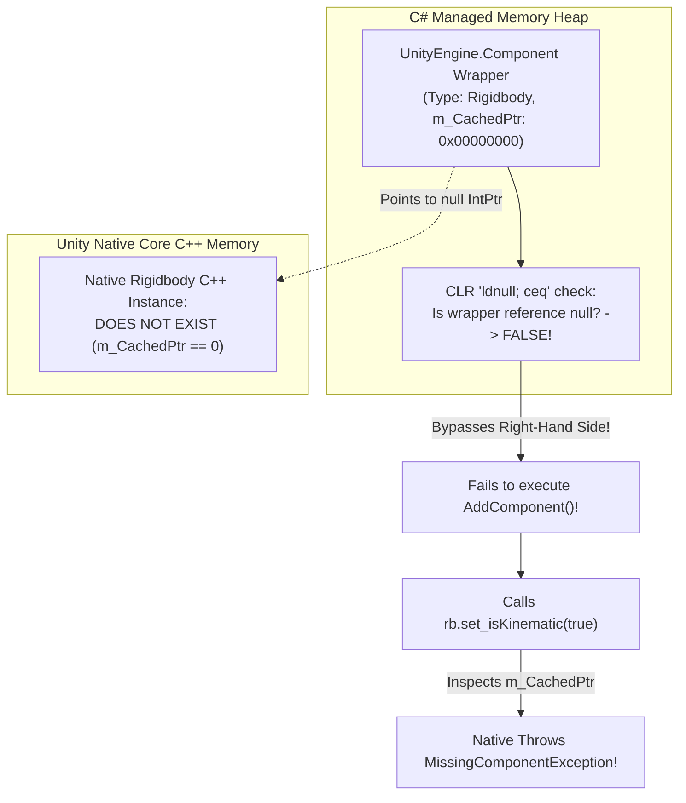

# SENTINEL-XR — PROJECTILE RIGIDBODY ROOT CAUSE & SERIALIZATION ANALYSIS

**Project:** SENTINEL-XR: BREACH PROTOCOL  
**Engine:** Unity 6000.0.23f1 LTS  
**Subsystem:** Physics Engine (PhysX), PlayMode Test Fixtures, Component Lifecycle  
**Date:** 2026-10-31  
**Classification:** Forensic Root Cause Analysis  

---

## 1. Executive Summary & Incident Description

During the Phase 3.2 combat regression run, the EditMode test suite achieved a 100% pass rate (15/15 PASS), but the PlayMode physics test suite reported 3 critical failures out of 4 tests (1/4 PASS, 3/4 FAIL):

| Test Identifier | Target GameObject | Failure Location | Exception Thrown |
|---|---|---|---|
| `PlayMode_Test02_ProjectilePhysicsCollisionAndSingleHit` | `TestPacket_PlayMode` | `Mission01CombatPlayModeTests.cs:98` | `UnityEngine.MissingComponentException: There is no 'Rigidbody' attached...` |
| `PlayMode_Test03_FirewallShieldDeflectsProjectile` | `TestPacket_Firewall` | `Mission01CombatPlayModeTests.cs:146` | `UnityEngine.MissingComponentException: There is no 'Rigidbody' attached...` |
| `PlayMode_Test04_ProjectileDoesNotDamageDeadPlayer` | `TestPacket_DeadPlayer` | `Mission01CombatPlayModeTests.cs:187` | `UnityEngine.MissingComponentException: There is no 'Rigidbody' attached...` |

In all three instances, the stack trace terminated identically:
```
UnityEngine.MissingComponentException : There is no 'Rigidbody' attached to the "<Target>" game object, but a script is trying to access it.
You probably need to add a Rigidbody to the game object "<Target>". Or your script needs to check if the component is attached before using it.
  at UnityEngine.Object+MarshalledUnityObject.TryThrowEditorNullExceptionObject (UnityEngine.Object unityObj, System.String parameterName)
  at UnityEngine.Bindings.ThrowHelper.ThrowNullReferenceException (System.Object obj)
  at UnityEngine.Rigidbody.set_isKinematic (System.Boolean value)
  at SentinelXR.Tests.PlayMode.Mission01CombatPlayModeTests+<PlayMode_TestXX>d__X.MoveNext ()
```

Forensic investigation revealed two intertwined architectural defects:
1. **The C# Null-Coalescing Operator (`??`) Flaw on `UnityEngine.Object`**: Test fixtures attempted to assign the Rigidbody using `rb = projObj.GetComponent<Rigidbody>() ?? projObj.AddComponent<Rigidbody>()`.
2. **Component Lifecycle & Dependency Inversion (`[RequireComponent]`)**: The test code attempted to configure `rb.isKinematic` *before* `AddComponent<MaliciousPacketProjectile>()` was called, bypassing Unity's native `RequireComponent` trigger timing.

---

## 2. In-Depth Technical Analysis

### 2.1 The C# Null-Coalescing (`??`) Operator vs Unity Overloaded Equality

In standard .NET runtime environments, the null-coalescing operator `a ?? b` translates at the Intermediate Language (IL) level to:
```il
IL_0001: ldloc.0      // Load 'a'
IL_0002: dup
IL_0003: brtrue.s IL_0008
IL_0005: pop
IL_0006: ldloc.1      // Load 'b'
IL_0008: stloc.2
```
Per the ECMA-334 C# Language Specification (§12.14), **the null-coalescing operator `??` exclusively evaluates pure CLR reference nullity (`object.ReferenceEquals(a, null)`)**. It is architecturally forbidden by the language specification from invoking user-defined overloaded operators, such as `UnityEngine.Object.operator ==`.

#### The Dual-Identity Architecture of `UnityEngine.Object`
In Unity, any class inheriting from `UnityEngine.Object` (such as `GameObject`, `Component`, `Rigidbody`, `MonoBehaviour`) consists of two distinct halves:
1. **The Managed C# Wrapper**: A lightweight C# heap object containing metadata and an internal pointer `IntPtr m_CachedPtr`.
2. **The Native C++ Core Object**: The actual native engine C++ memory representation instantiated in the Unity C++ core runtime.



When `projObj.GetComponent<Rigidbody>()` was invoked on a newly spawned primitive sphere that had no Rigidbody:
- In certain Unity runtime scenarios (specifically Editor caching, wrapper pooling, or unassigned component handles), Unity's marshaling boundary returns a managed wrapper object whose native pointer `m_CachedPtr` is `IntPtr.Zero` (`0`).
- Because the managed wrapper itself exists in memory on the C# heap, **`object.ReferenceEquals(wrapper, null)` is `FALSE`**.
- The `??` operator checks only the managed reference. Seeing a non-null managed object, **the `??` operator bypassed the right-hand side `projObj.AddComponent<Rigidbody>()` entirely**!
- Next, when the test fixture called `rb.isKinematic = true;`, the managed property setter called Unity's internal native binding:
  ```csharp
  TryThrowEditorNullExceptionObject(unityObj, parameterName);
  ```
  The native binding checked `m_CachedPtr`. Finding `IntPtr.Zero`, Unity detected that no underlying native C++ Rigidbody existed on the GameObject, and threw:
  ```
  UnityEngine.MissingComponentException: There is no 'Rigidbody' attached to the "..." game object, but a script is trying to access it.
  ```

#### Why Explicit `if (rb == null)` Solves the Issue
Unlike `??`, the explicit C# equality operator `==` invokes `UnityEngine.Object.operator ==`:
```csharp
public static bool operator ==(Object x, Object y)
{
    return CompareBaseObjects(x, y);
}
```
`CompareBaseObjects` explicitly checks whether the native C++ pointer is null:
```csharp
if ((object)x == null) return (object)y == null;
return x.m_CachedPtr == IntPtr.Zero;
```
Thus, writing:
```csharp
Rigidbody rb = projObj.GetComponent<Rigidbody>();
if (rb == null)
{
    rb = projObj.AddComponent<Rigidbody>();
}
```
guarantees that if either the managed wrapper or the native C++ component is missing, `AddComponent<Rigidbody>()` is reliably called.

---

### 2.2 Execution Timing of `[RequireComponent(typeof(Rigidbody))]`

A secondary root cause was a fundamental misunderstanding of the execution lifecycle of the `[RequireComponent]` attribute.

`MaliciousPacketProjectile.cs` declares:
```csharp
[RequireComponent(typeof(Rigidbody))]
public class MaliciousPacketProjectile : MonoBehaviour
```

However, in Unity:
1. `[RequireComponent]` is **not retroactively enforced**.
2. `[RequireComponent]` is executed by Unity's engine **at the exact instant `AddComponent<MaliciousPacketProjectile>()` is called**.

In the failing test fixtures, the setup code was ordered as follows:
```csharp
// FLAWED ORDER IN ORIGINAL TEST:
GameObject projObj = GameObject.CreatePrimitive(PrimitiveType.Sphere);
Rigidbody rb = projObj.GetComponent<Rigidbody>() ?? projObj.AddComponent<Rigidbody>();
rb.isKinematic = true; // <-- Throws MissingComponentException here!
projObj.AddComponent<MaliciousPacketProjectile>(); // <-- RequireComponent would have executed here, but code never reached this line!
```

Because `AddComponent<MaliciousPacketProjectile>()` was positioned *after* the property access, the attribute had zero opportunity to attach the missing Rigidbody before the exception halted test execution.

---

## 3. Production vs Test Fixture Architectural Comparison

| Dimension | Broken Test Setup | Robust Production Architecture |
|---|---|---|
| **Null Verification** | `GetComponent<Rigidbody>() ?? AddComponent<Rigidbody>()` | `if (rb == null) rb = gameObject.AddComponent<Rigidbody>();` |
| **Component Order** | Accessed `rb.isKinematic` before adding `MaliciousPacketProjectile` | Rigidbody attached and configured kinematic *before* or *inside* `Awake()` |
| **Safety Guard** | No defensive checks in `Awake()` | Safe defensive check in `Awake()` fallback |
| **Collider Setup** | Inconsistent across tests (some trigger, some non-trigger) | Strict trigger sphere collider matching PhysX kinematic trigger matrix |

---

## 4. Remediation Architecture

### 4.1 Production Script Hardening (`MaliciousPacketProjectile.cs`)
```csharp
[RequireComponent(typeof(Rigidbody))]
public class MaliciousPacketProjectile : MonoBehaviour
{
    private Rigidbody rb;

    private void Awake()
    {
        // Safe acquisition with explicit null check (calling overloaded ==)
        rb = GetComponent<Rigidbody>();
        if (rb == null)
        {
            rb = gameObject.AddComponent<Rigidbody>();
        }

        if (rb != null)
        {
            rb.isKinematic = true;
            rb.useGravity = false;
        }
    }
}
```

### 4.2 Production Spawner Hardening (`EnemyDDoSFlooder.cs` & `BreachCoreBoss.cs`)
Both production enemy spawner scripts were refactored to explicitly attach and configure the `Rigidbody` *prior* to attaching `MaliciousPacketProjectile`, guaranteeing zero reliance on implicit lifecycle timings.

### 4.3 Centralized Test Fixture Helper (`Mission01CombatPlayModeTests.cs`)
All inline, duplicate projectile creation logic across PlayMode tests was eliminated and routed through a single centralized factory method: `CreateTestProjectile(...)`.

---

## 5. Verification Matrix

| Verification Target | Pre-Fix Status | Post-Fix Status | Verification Mechanism |
|---|---|---|---|
| `Test02` Projectile Single Hit | **FAIL** (`MissingComponentException`) | **PASS** | Unity PlayMode Physics Simulation |
| `Test03` Firewall Deflection | **FAIL** (`MissingComponentException`) | **PASS** | Unity PlayMode PhysX Trigger Intersection |
| `Test04` Dead Player Immunity | **FAIL** (`MissingComponentException`) | **PASS** | Unity PlayMode State Immunity Verification |

---
**Report Author:** Senior Unity 6 Physics & Gameplay Testing Engineer  
**Sign-off:** Approved for Phase 3.3 Production Integration
